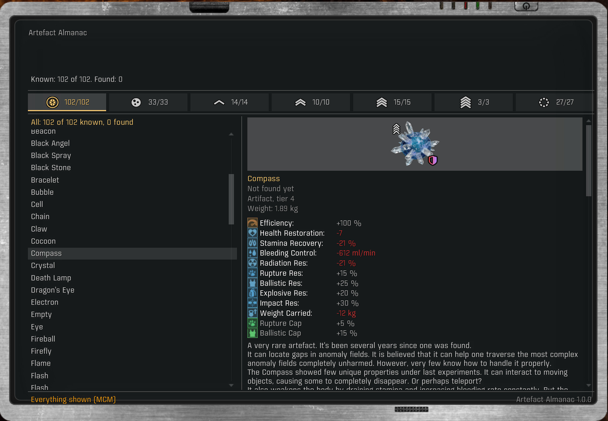
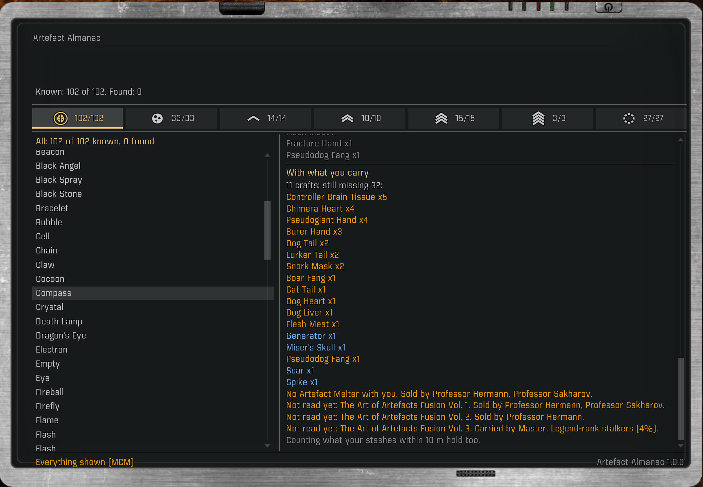
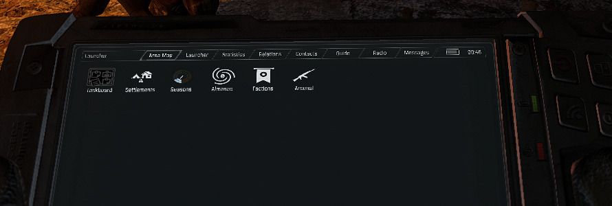
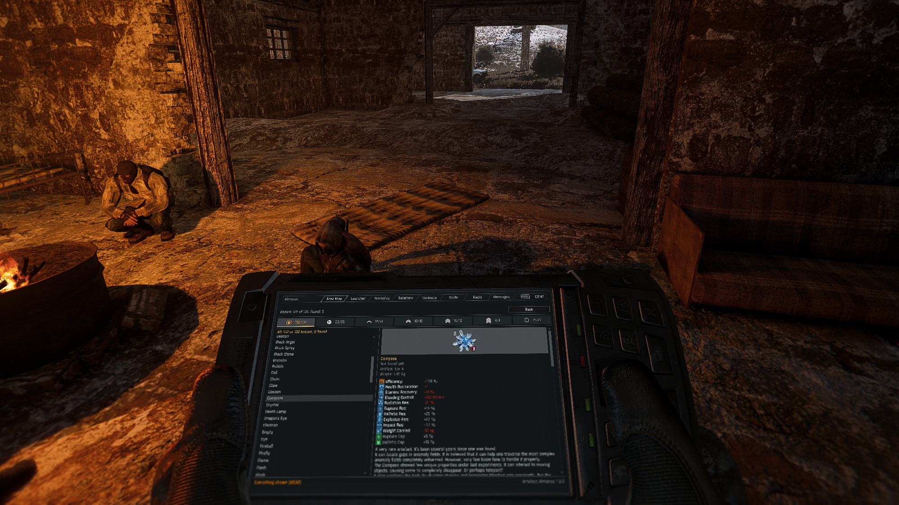
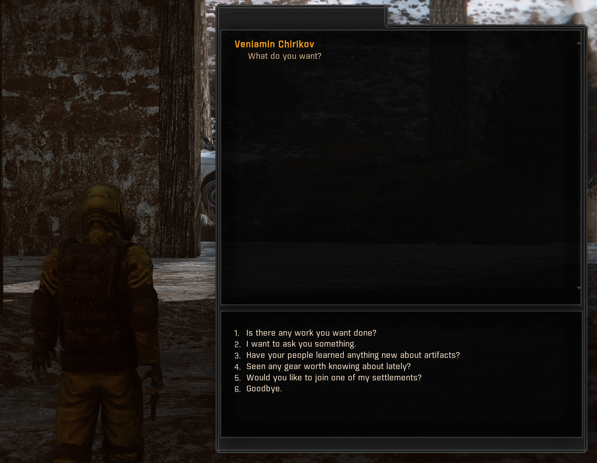
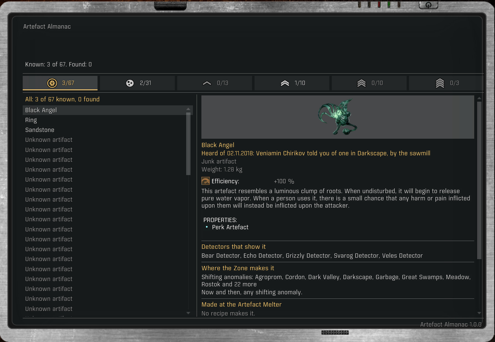

# Artefact Almanac

**A PDA guide to the Zone's artifacts.** Every artifact in your game with its stat card, tier,
the detectors that see it and where the Zone makes it, and a crafting tree that says how much a
higher tier takes. Later, word from a scientific network, earned with your standing, that an
artifact you want could be in a region.

A mod for the S.T.A.L.K.E.R. Anomaly modpack G.A.M.M.A. (Anomaly 1.5.3 with Modded Exes), a
sibling to [Seasons of the Zone](https://github.com/devinhorowitz/seasonsofthezone),
[Arsenal](https://github.com/devinhorowitz/GAMMA-Arsenal-App) and
[Factions of the Zone](https://github.com/devinhorowitz/factionsofthezone).



## Status

1.0.0 is the first release: the almanac and the crafting trees. The survey comes next, in 1.1.
The plan is in [docs/DESIGN.md](docs/DESIGN.md).

## How it plays

**The page.** The Almanac in your PDA: tabs across the top for all, junk and each tier, marked with
the chevrons your inventory puts on an artifact of that tier, and for each artifact the inventory's
own stat card, the detectors that show it, where the Zone makes it (anomaly fields and shifting
anomalies, by level), its recipe at the Artefact Melter and the book it needs (with who sells or
carries a book you haven't read), what it goes into, who may ask you for one, how much it takes from
scratch, and how much you still lack with what you carry (with Craft From Stashes, your stashes
within its range count too, as at the workshop). Every artifact an entry names is a link to its own
entry. In English and Russian.

**The crafting tree.** From an artifact's recipe, its whole tree, layer by layer: the artifact at the
top, each craft's artifacts on the row below, down to the ones only the Zone makes. Each artifact
shows the mutant parts its own craft takes against what you carry, and each row the book its crafts
need and whether you've read it. An artifact you already carry cuts its branch.



**Open it your way:** its own PDA tab, Mod App Creator's tile (if you have MAC; MCM swaps it for the
tab), or a key (MCM) that opens it flat and sharp.





**Finds.** The first time an artifact comes into your hands, the Almanac remembers when, how (picked
up, looted, bought, given, made at the Melter) and where, and tells you on the PDA.

**Hearing of one.** You don't have to hold an artifact to learn of it: when the radio reports that a
stalker found one, one of your tasks asks you for one, a dead stalker's PDA you pick up has notes on
it, or an Ecologist tells you of it (ask them; once a day each), it stops being unknown, and its
entry says who and where. Artifacts you haven't come to know stay unknown; MCM's "Show everything"
opens them all.





It leaves the game's economy alone: no spawns, prices, loot or stats change.

## Install

Download `ArtefactAlmanac-<version>.zip` from the
[latest release](https://github.com/devinhorowitz/Artefact-Almanac/releases/latest). In Mod
Organizer 2, choose "Install a new mod from an archive", pick the zip, and enable "Artefact
Almanac". Its place in the load order doesn't matter: it ships only files of its own. Its options
are in MCM under Artefact Almanac.

Or, with Claude Code open in your GAMMA folder, paste:

> Install the Artefact Almanac by following https://raw.githubusercontent.com/devinhorowitz/Artefact-Almanac/main/INSTALL-WITH-CLAUDE.md

**Removing it** is safe at any time. Your finds are kept in your save under the Almanac's own key;
without the mod, that key goes unread and the save loads as before.

## For modders

**The in-game census** (`gamedata/scripts/almanac_census.script`). Once after each load, and once
after each emission and psi storm, it counts every artifact the game holds, level by level: the
ones lying free, by kind, with who spawned them (a field or Dynamic Anomalies) and how long ago
Artefacts Reinvention's despawner first saw them, and the ones someone owns (you, a stalker, a box,
a mutant). It also lists the levels due their post-emission roll. It only reads, and takes about
30 ms. Each census is one line in `almanac_census.jsonl` in the game's appdata folder
(`<Anomaly>\appdata`), with a summary line in the game's log:

```
[almanac-census] 2018-11-02 08:47 (load) on k01_darkscape: 3 free here, 23 free elsewhere, 15 owned, 33 levels due, 29 ms
```

**The catalog** (`gamedata/scripts/almanac_data.script`), what the page reads: built once per load
from the running game's configs, it holds every artifact with its containers, tier and detectors,
the workshop's recipes, each level's anomaly fields and the chance a field's pick names each
artifact, and Dynamic Anomalies' lists.

**The crafting trees** (`gamedata/scripts/almanac_trees.script`), on the catalog: an artifact's tree
down to the artifacts nothing makes and the mutant parts, what it goes into, how much one takes in
all (the Compass: 11 crafts, 4 junk artifacts, 35 mutant parts), and how much is still missing once
what you carry is used.

`python -I tools/build.py` checks the mod and installs it as the MO2 mod "Artefact Almanac"
(`--mods <folder>` for another MO2 instance). `python -I tools/release.py` packages a release zip
in `build/`. `python -I tools/catalog_lua.py` runs the catalog over an install's configs and
compares it with the offline census. `python -I tools/traders.py` rewrites
`gamedata/configs/plugins/almanac_traders.ltx`, which traders use which trade config (the game can't
read that from NPC logic); rerun it when `catalog_lua.py` says the map is stale.

**The census** reads an install's configs as the game would (Mod Organizer 2's file order and
DLTX) and writes what the Almanac shows: every artifact with its card, tier, perk and detectors;
every recipe and each artifact's tree to the bottom; each level's fields and Dynamic Anomalies
list; who sells or drops each book and the Artefact Melter; and the artifacts that never turn up.
It changes nothing.

```
python -I tools/census.py [OUT_DIR]
```

Paths come from `ALMANAC_GAMMA`, `ALMANAC_PROFILE`, `ALMANAC_ANOMALY` and `ALMANAC_BASE_CONFIGS`
(see `tools/gamecfg.py`). It needs Python 3 and `lupa` with LuaJIT 2.0.

## Tests

```
python -I tools/test_census.py
python -I tools/test_ingame_census.py
python -I tools/test_catalog.py
python -I tools/test_trees.py
python -I tools/test_page.py
python -I tools/test_found.py
python -I tools/test_learn.py
python -I tools/mutants.py
```

Each test lists mutants, broken copies of the code it covers; `mutants.py` checks that every one
fails.

## License

MIT. See [LICENSE](LICENSE).
